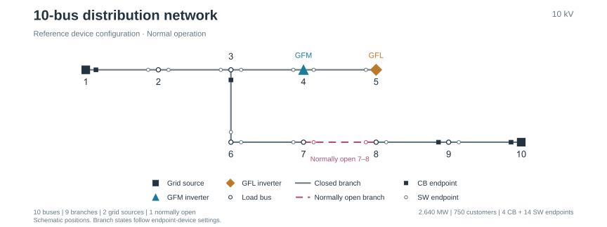
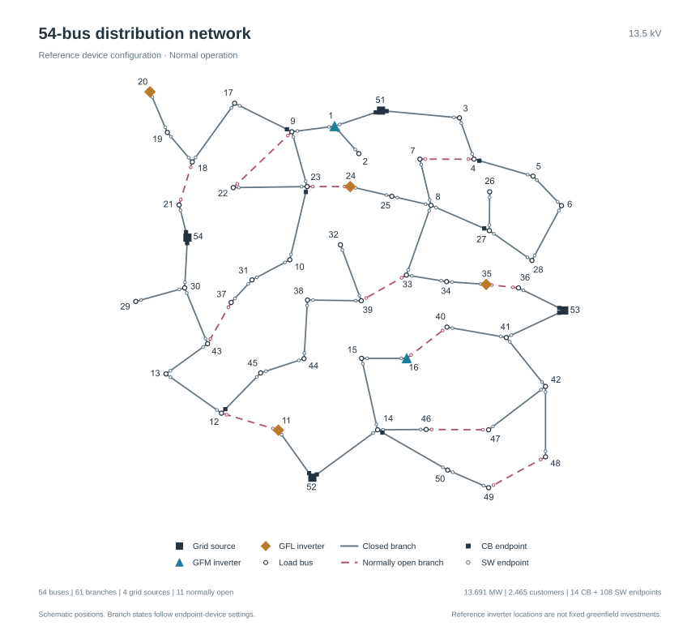

# Supplementary Appendix and Input Datasets

Supporting materials for **Optimization-Based Explicit Reliability Assessment for Joint Planning of Switches and Grid-Forming Resources in Distribution Networks**.

## Test system topologies

**Normal-operation reference layouts, generated with Python.** Click either diagram for its scalable SVG version, or download the 600 dpi PNG below it.

### 10-bus network

[](figures/topology_10bus.svg)

**10 buses · 9 branches · 2 grid sources · 1 normally open tie.** The reference GFM and GFL are at buses 4 and 5, respectively; the normally open tie is 7–8.

[Download 600 dpi PNG — 7200 × 2700](figures/topology_10bus.png) · [Open scalable SVG](figures/topology_10bus.svg)

### 54-bus network

[](figures/topology_54bus.svg)

**54 buses · 61 branches · 4 grid sources · 11 normally open ties.** Reference GFMs are at buses 1 and 16; reference GFLs are at buses 11, 20, 24, and 35. Branch 27–28 is normally closed and branch 35–36 is normally open.

[Download 600 dpi PNG — 7200 × 6480](figures/topology_54bus.png) · [Open scalable SVG](figures/topology_54bus.svg)

Solid lines denote closed branches; dashed lines denote normally open branches. Squares, triangles, diamonds, and circles distinguish grid sources, GFM/GFL inverters, load buses, and endpoint devices as defined in each legend. The diagrams use schematic positions and endpoint-defined normal states. **The reference inverter locations are not mandatory investments in the 54-bus greenfield plans.**

## Files

| File | Contents |
| --- | --- |
| `IEEE_PESGM_2027_Appendix_Complete.docx` | Complete model, derivations, mixed-integer reformulations, experimental settings, and numerical configuration tables. Equations are editable in Word. |
| `omra_case_10node_data.xlsx` | Base network data and reference device configurations for the 10-bus test system. |
| `omra_case_54node_data.xlsx` | Base network data and reference device configurations for the 54-bus test system. |
| `figures/` | High-resolution PNGs, scalable SVG topology diagrams, and a topology audit record. |
| `scripts/plot_topologies.py` | Standalone Python script that regenerates both topology diagrams from the two workbooks. |

## How to use the materials

The Excel workbooks provide base network data and reference device configurations. **The experiment-specific settings and overrides in Section H of the Supplementary Appendix take precedence over workbook defaults when interpreting the reported experiments.** These include inverter ratings and types, device availability, planning candidates, and the normal topology used in the study. The workbooks alone do not uniquely specify every experiment.

The appendix is organized as follows:

- **A:** Sets, variables, and assumptions.
- **B:** Protection, restoration, radiality, and reference eligibility.
- **C:** Electrical operating snapshots and disturbance definitions.
- **D:** Analytical frequency response and topology-dependent aggregation.
- **E:** Reliability indices and investment optimization.
- **F:** Exact mixed-integer reformulations and approximation bounds.
- **G:** Local two-step switch-defined pickup experiment.
- **H:** Network data, frequency settings, candidate ratings, and experimental configurations.
- **I:** Computation, verification, and reproduction settings.

## Experimental distinctions

The 10-bus two-step experiment concerns only the isolated buses 4 and 5 following fault 3–4. Its reported EENS is the annual contribution of those buses under that fault. The separate whole-network switch–GFM interaction comparisons aggregate all eight modeled branch faults and use one restoration state per fault. The parameter overrides for these experiments differ; see Sections G and H2.

For the 54-bus planning study, the actual normal topology is derived from endpoint-device states: **branch 27–28 is normally closed and included in the fault set, while branch 35–36 is normally open and excluded.** These states resolve legacy inconsistencies in the workbook's branch flags. See Sections H3–H4 for the actual topology, planning candidates, costs, budgets, and full asset configurations.

## Regenerate the topology diagrams

From the repository root, install the plotting dependencies and run:

```bash
python -m pip install matplotlib numpy networkx openpyxl pillow
python scripts/plot_topologies.py
```

The script exports both SVG diagrams and 600 dpi PNGs to `figures/`. It derives branch closure from both physical endpoint states and checks the radial normal-operation components, source assignments, branch counts, and the 27–28/35–36 convention. It generates `figures/topology_audit.json` with topology counts, image dimensions, and workbook checksums. The script only generates diagrams; it does not run the reliability optimization.

This repository contains the supplementary document and input datasets. It does not contain the optimization source code or an executable reproduction package. Solver settings and verification descriptions are documented in the appendix; they should be interpreted together with the stated modeling assumptions and experiment-specific overrides.
